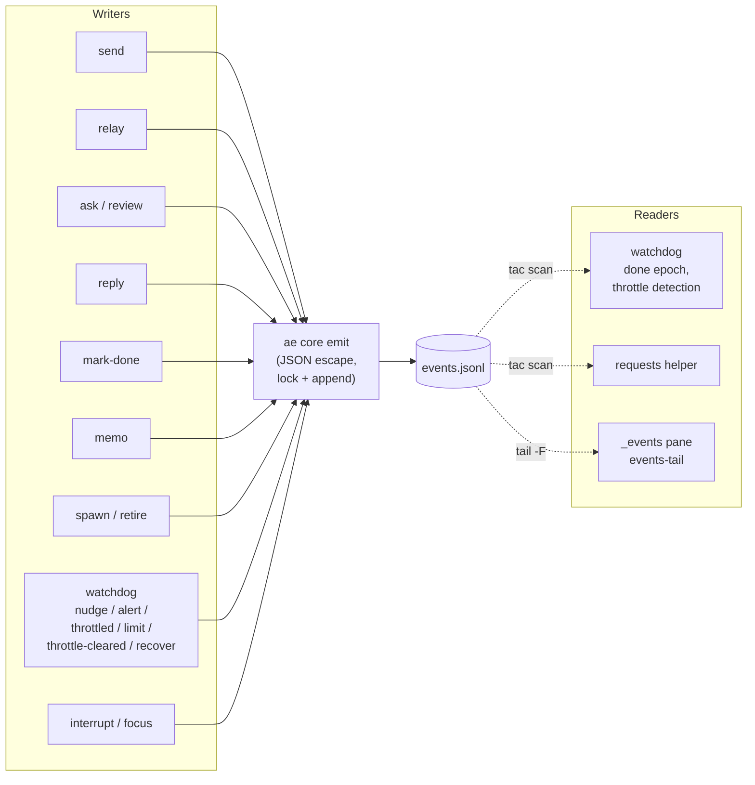

# Events

`~/.ae/sessions/<name>/events.jsonl` is ae's single durable record of what happened. Mutating helpers and ae internals write structured events; inspection helpers (`peek`, `agents`, `requests`, `events-tail`, `watchdog status`) read but don't write. The watchdog reads events to enforce its done-invalidation contract; `requests` derives `pending` (annotated `accepted` by an `accept`), `replied`, `cancelled` and `retired` state from them. Append-only, one JSON object per line.

## Producers and consumers

Single writer, single file, multiple readers. The writer is the ae core, reached through whichever helper link the agent called. The append-only structure plus lock-serialized writes mean readers can scan safely without coordination.



Inspection helpers (`peek`, `agents`, `requests`, `events-tail`, `watchdog status`) read but don't write. Mutating helpers and the watchdog write through the core's single emit choke point.

## Schema

Every event has these keys; `target`, `ref`, and `summary` are optional and omitted when empty.

```json
{
  "ts":      "2026-05-19T07:29:45Z",        // ISO 8601 UTC, second precision
  "actor":   "lead",                        // bare name of the emitter (or 'watchdog', 'human')
  "action":  "done",                        // event type — see below
  "target":  "coworker",                    // bare name of the recipient when applicable
  "ref":     "ae-20260519T072100Z-abc123",  // polysemous — see action table
  "summary": "action-specific payload view", // optional; usually flattened and truncated
  "schema_version": 1                        // journal schema, written last; absent reads as v0
}
```

`ref` carries different correlation values depending on `action`:

- `ask` / `review` / `reply` — the request id pairing the three.
- `memo` — the topic the memo was filed under.
- `recover` — the captured session id (Codex/Gemini/OpenCode UUID).
- Other actions — usually absent.

String values are JSON-escaped: `\"` `\\` `\n` `\t` `\r`, and every control character (C0, DEL, C1) is written as a `\u00XX` escape. Rendering is the core's (`src/json.rs`); the flat schema stays cheap for any reader to parse a line at a time.

### Routing-key fields

Messaging events (`send` / `relay` / `ask` / `review` / `reply`) also carry the sender's and recipient's **slot** and **session** when known — the churn-proof routing key that survives a display-name change (see [slot identity](../reference/helpers.md#slot-identity)). A refused `relay` row keeps the full exact text, in the caller only; a claimed relay's text is its `relay-attempt` body file:

```json
{
  "actor_slot":     "main",         // sender's slot: main | worker.<n> | spawned.<n>
  "actor_session":  "my-feature",   // sender's session
  "target_slot":    "worker.0",     // recipient's slot
  "target_session": "my-feature"    // recipient's session
}
```

Each is optional and omitted when empty. Readers that don't understand them ignore them; readers that do (`reply`, `requests`) prefer slot + session over the display name for pairing and delivery.

`ask`, `review` and `reply` also pin each routed end by its session's meta `session_id`: `actor_session_id` and `target_session_id`, written only beside a slot. A reader that knows its own session's id judges a pinned end BY THAT ID, so a request survives `ae rename` and a session that later takes the old name never answers it; against a legacy record the name is all the two share. A present but non-canonical id names nobody (`Identity::Unassociated`) and never falls back to the name. Every request reader takes the two ids through the strict event parser, never a scrape: a wrong type, a duplicate, or any line the schema refuses whose decoded JSON object names either key (escaped or not), is unusable; the older routing members keep their scrape. `reply` finds a pinned asker in the one session recording its id and refuses, naming the id, when none or several do. `ae rename` refuses while a pending request has an end matched by name alone in the renamed session. Named residual: the watchdog's done and wait folds and the chat's open asks stay name-only, because the records they judge carry no id — so a reply to an ask the seat opened BEFORE a rename does not end that seat's `waiting-agent` quiet.

### Incarnation fields

Additive facts that prove a pane's session across servers and tmux incarnations. Older events omit them; older readers ignore them. Empty values are unwritten.

```json
{
  "target_server":        "/tmp/tmux-501/default",  // #{socket_path} of the admitted target
  "target_pane":          "%9",                     // pane id of the admitted target
  "target_session_uuid":  "1b4e28ba-2fa1-11d2-883f-0016d3cc4321",
  "caller_server":        "/tmp/tmux-501/default",  // #{socket_path} of the calling pane
  "caller_pane":          "%3",
  "caller_session_uuid":  "1b4e28ba-2fa1-11d2-883f-0016d3cc4321"
}
```

`ask` / `review` write the **target** triple after proving pane UUID == target meta, re-observed after delivery. `reply` and `memo` write the **caller** triple, re-observed after the durable cut (`memo.tsv` append or reply delivery). If identity cannot be proved, or changes across the cut, the triple fields are omitted. When a session identity existed and correlation failed, the durable record names the failed leg in `identity_gap` (`CorrelationOutcome::name`: unreadable, vacant, mismatch, meta gaps). When there was **no session identity to correlate against** — the caller has no pane context, or neither the pane nor the `meta` records one — **no `identity_gap` key is written at all**: the question never arose, and an absent context is not a failed correlation. Nothing about identity is ever written to stderr — RECORD, DO NOT BROADCAST; the writer boundary has no error stream. This is plumbing for later consumers (`compactseats`, request waiters); it does not change `ae reboot`.

`requests` exposes the opening target triple as `recorded_target`. Two questions, never collapsed:

- `caller_matches_live` — is this record from the incarnation that is here NOW?
- `caller_matches_recorded_target` — is the responder the incarnation this request opened against?

Every `ask` / `review` also records `actor_launch_id` and `target_launch_id` when that endpoint has a seat token. Each token must be present and unchanged across delivery in the endpoint's UUID-matching meta; slotless actors and missing or damaged tokens get no guessed or empty key. The same opening line is mirrored. The strict reader retains absent, empty and valued tokens distinctly, rejects wrong types and duplicate keys, and older cores ignore these additive keys. A reply into an orchestrator role consumes one unique Pending opening, equal in both participant ledgers, and requires both current UUID/slot/launch bindings. Accept, withdraw and mirror repair share that strict fold; a repair exempts only its original closing line. Reseat/retire changes the binding; relaunch preserves it.

At rollout, legacy role-opened requests without both launch keys refuse with a report-to-own-lead instruction; ask again. An ordinary request also refuses accept with "asker session unproven" after its recorded asker UUID no longer belongs to any session, including after the asker session ends. Older cores ignore the additive launch keys. Plain-terminal or unstamped role-directed helpers (including goal writes, compact and spawn) refuse; owners use the role pane, ae chat, ae app or Telegram. Same-session monitor families still land by physical session membership. This is helper policy: raw tmux access, same-user meta/journal writes and a forged new session alias targeting a real role pane are named residuals.

### Body file

`body_file` is the path of the text a delivery stored under the session's `messages/` (`<ref>.<action>.<6 hex>.txt`, mode 0600), when it stored one: a `send` / `ask` / `review` / `interrupt` delivery, and a `reply` to `console:local`, which keeps its whole body (at most 65536 bytes) there. A string key, policed for duplicates like every known key; an older core steps over it as unknown data and keeps the record, summary included. `ae chat` reads it by NAME from its own session's `messages/`, never through the recorded directory, a link or a separator, and a body it cannot read shows as a named gap beside the 600-character summary.

`unverifiable` is a string reason why a delivery's submit could not be verified.
Its presence, even an empty string, makes a console ask's receipt `Uncertain`
and keeps its recovery draft. A wrong type or duplicate key invalidates the
record; an older core steps over the additive key as unknown data.

`outcome` is a `relay-result`'s transport word, as written: `sent`, `uncertain`
or `not-delivered`, judged by its reader. A wrong type or duplicate key
invalidates the record; an older core steps over the additive key.

`relay_origin` is the emitting orchestrator session's `session_id`, as written,
on a `console:local` ask. It is audit data, never authority: the open-ask count,
the cap and `/close` ignore it. `ae chat` and `ae app` badge the ask
`via orchestrator <name>`, the name read at render time from the session whose
meta `session_id` equals it; no such session, or more than one, reads
`(name unavailable)`, and a value that is not a canonical UUID, the empty string
included, reads `(origin unreadable)`. The UUID itself is never shown. Presence
is kept as written; a wrong type or duplicate key invalidates the record, and an
older core steps over the additive key as unknown data.

## Actions

| Action | Emitted by | Meaning |
|---|---|---|
| `send` | `send` helper | One-way message between agents (or from human / watchdog). |
| `relay` | `relay` helper | A relay refused before its claim, in the caller ledger: target + full text, no `ref`. |
| `relay-attempt` | `relay` helper | Caller ledger: the claim, durable before any target key; `ref` = the target ask's id, `body_file` the exact text. |
| `relay-result` | `relay` helper | Caller ledger: the claim's `outcome`; the target journal holds the `console:local` ask with `relay_origin`. |
| `ask` | `ask` helper; `ae chat` input as `console:local` (stored; agents see it rendered as `human:chat`) | Tracked request expecting a reply. Carries `ref`. |
| `review` | `review` helper | Like `ask`, with the critical-review prompt template. Carries `ref`. |
| `reply` | `reply` helper | Reply to an `ask` / `review`. Same `ref`. |
| `state` | `state` helper | Agent declares its work state — `working` / `waiting-user` / `waiting-agent` / `blocked` / `done` (in `ref`). The watchdog honors quiet states; a `waiting-agent` past its ceiling reads as `blocked`. |
| `done` | `mark-done` helper | Completion / pause signal. `mark-done` is an alias for `state done`; both are read as `done`. |
| `chat` | `say` helper | Agent's free-text line to the human, forwarded by the Telegram bridge when a lead-pair seat (or the watchdog) wrote it. Text in `summary`. |
| `memo` | `memo add` helper | Append to shared session memory. |
| `spawn` | ae internal | A new agent joined the workspace. |
| `retire` | ae internal | A spawned agent was removed. |
| `focus` | `focus` helper | tmux focus switch (informational). |
| `interrupt` | `interrupt` helper | Cancel signal sent. |
| `nudge` | watchdog | Stale-agent status check. |
| `alert` | watchdog / ae internal | Attention required (dead, max-nudges, persistent throttle, missing pane). |
| `throttled` | watchdog | First cycle of an upstream throttle streak. |
| `limit` | watchdog | First cycle of a vendor usage-limit episode; one per episode. Reads as `attn:limit` (rank 3). |
| `alert-cleared` | watchdog | Retraction of a standing watchdog alert (a limit episode's release, a recovered stale alert, …). |
| `throttle-cleared` | watchdog | Throttle pattern no longer present. |
| `dead-cleared` | watchdog | The dead agent's process is positively back (re-run in place); retracts the `alert`. |
| `recover` | watchdog | Post-launch session id captured for a previously-pending slot. |
| `conversation-resumed` / `-unproven` / `-new` / `-lost-no-id` / `-lost-not-found` / `-lost-unreadable` | `_run`, actor `watchdog` | Which conversation one tool start CHOSE, written before the exec: an exact resume the store probe proved, one no probe could check, a first start, or a fresh start passing over no recorded id, an id its store lacks, or a store it could not read. `target` = the agent; `ref` = `<slot>:<launch_id>:<pid> <prior\|-> <id\|pending>`, the `_run` pid, the passed-over id (losses with an id only) and the id launched (`pending` until captured). A decision, never proof of context; `src/conversation.rs` decodes it, a ref breaking the grammar is damage. A failed append is said on stderr and the tool still starts. The chat lane shows each loss; `ae list` shows the running start's choice (`conv:` cell, JSON `conversation`). A loss also ends the seat's own launch context with one `CONVERSATION:` line, except for a tool with no context channel and a failed opencode instruction-file write. |
| `legacy-reap` | watchdog | At daemon start, the pre-rename reap's outcome: every legacy pane it found (reaped, or refused with why), or that the panes could not be listed. No `target`; neutral to `alert_meaning`. |
| `watchdog-start` | `ae watchdog start` | Audit: who started the watchdog, and the outcome (`started`, `already running`, `refused: …`). Actor is the caller stamp — bare in its own session (reads as that agent's own activity, like `relaunch`), `session:agent` abroad — `human` when unprovable, `ae:upgrade`/`ae:rename` for ae-driven restarts. Carries no `target`; neutral to `alert_meaning`. Shown in the Activity dialog unless ae-driven. |
| `watchdog-stop` | `ae watchdog stop` | Audit: who stopped the watchdog, and the outcome (`stopped`, `not running`, `refused: …`). Same actor spellings, neutrality and Activity listing as `watchdog-start`. |
| `goal` | `goal` helper | The goal was set or cleared (`goal cleared`); an unchanged goal writes none. Carries `actor_slot`/`actor_session`/`actor_session_id` when the setter's pane was proven. Setters are serialized from the unchanged check through this record, so the newest names the published goal. Arms a goal notice. |
| `rename` | `ae rename` (actor `ae:rename`) | A live rename, `<old> -> <new>`, written in the renamed journal after `workspace.md` is published. A stopped rename writes none. Arms a rename notice. |
| `session-notice-attempt` | watchdog (notice leg) | One notice attempt to `target`/`target_slot`, summary `<rename\|goal> <launch_id>`, `ref` `sn-<stamp>-<hex>`. Journaled BEFORE the text is read from meta. |
| `session-notice` | watchdog (notice leg) | That attempt landed (`[unconfirmed]` prefix when the submit was not proven). Same `ref`. |
| `session-notice-failed` | watchdog (notice leg) | That attempt failed, `<kind> <reason>`: `storage`, `busy`, `paste`, `refused`, or `meta-unread` (the goal could not be read, nothing pasted). Same `ref`. |
| `session-notice-gave-up` | watchdog (notice leg) | The third failure of one kind since its source, on the third failed attempt's `ref`, `<kind> <launch_id>`; booked by a later leg if lost, never with a paste. Nothing more until a newer source. |

## Session notices

`src/session_notice.rs` owns them. The pure fold judges each seat in journal ORDER: its
boundary is its newest `spawn` (by `target`), `reseat` or `relaunch` (by `target_slot`); with
none, a source counts only when STRICTLY newer than `launch_time.<slot>`. An attempt counts
only for the seat's current `launch_id`. A rename is owed after the newest told rename
attempt; a goal (main and the lead-pair colead only, never to the seat that set it) after the
newest told attempt of either kind, because the rename text carries the goal. An attempt with
no ending is in flight for two daemon intervals, then retried (at-least-once). The daemon
triggers the send helper with `_AE_EVENT_ACTION=session-notice-due`; the leg folds again under
the target lock (tried without waiting), skips a busy, drafted, prompted or non-idle seat
writing nothing, and pastes a `⟦ae:ctx⟧` turn. Residual: a source landing between the
attempt and the paste is pasted next cycle, not this one.

## How `requests` reads events

`requests [mine|inbox|all] [--limit N]` walks `events.jsonl` backward via `tac` and collects:

- The latest `ask` / `review` event per `ref` → request row.
- The latest `reply` or authorized `cancel` event per `ref` → terminal row.
- The ledger's forward `open_requests` reading → whether an otherwise-pending valid row is `retired` because either party's seat was retired.

A request is `replied` only when the reply's `actor` equals the request's `target` AND the reply's `target` equals the request's `actor`. Stray reply events (wrong actor / wrong target) leave the request `pending`. An authorized withdrawal is `cancelled`; a request closed by either party's seat retirement is `retired`, not `replied`. Without the reply check a misrouted or manual reply could falsely close a request. The printed table is bounded — every pending row plus the newest 10 closed (`--limit N` overrides, `0` shows all) — with one footer line naming the hidden count and the full command when rows are hidden.

The core's request lookup returns the matched request as a tab-separated row. When the event carries routing-key fields the row is seven columns — `action  actor  target  actor_slot  actor_session  target_slot  target_session` — and `reply` verifies the responder's live slot against `target_slot` + `target_session` before delivering, so identity survives a name change. An event without those fields yields a three-column row (`action  actor  target`) and pairing falls back to the display name. The sensor also carries the opening `target_server` / `target_pane` / `target_session_uuid` when present (`Request::recorded_target`); those members are not printed on the seven-column table.

## How `_agent_done_epoch` reads events

```bash
_agent_done_epoch <agent>
# Returns the epoch (unix seconds) of the agent's most recent done event,
# IF that done is the latest "relevant" event for the agent — meaning the
# agent is the actor or target of no newer event. Otherwise empty.
```

"Relevant" = `actor == agent` OR `target == agent` OR `target == @<this-session>:<agent>` (cross-session targeting). Scan is newest-first via `tac` and stops at the first relevant match. Unbounded by design so a `done` event stays valid however many unrelated events follow it.

## Reading events live

The hidden `ae-monitor` window has an `_events` pane running the `events-tail` helper. It prints a formatted column view with `MM-DDTHH:MM:SS` UTC timestamps:

```text
05-19T07:29:14  nudge    watchdog               → claude:lead          idle 90m, no recent ae activity
05-19T07:29:45  done     claude:lead                                   All ae streamline + throttle detection...
05-19T09:05:14  nudge    watchdog               → claude:lead          idle 95m, no recent ae activity
```

`peek _events [n]` for a snapshot from any pane.

## Schema stability

Adding new optional keys is fine — readers ignore unknown ones. Renaming or removing keys is breaking and needs its own migration story, not a version bump. The keys above are the stable surface.

### Schema version

Every record ae appends ends in `"schema_version":1`. A record without it is **v0**, written before the field existed. Existing records are never migrated: a resume's trim only drops older lines (re-terminating each kept one with LF) and the archive copies bytes. One journal therefore holds v0 and v1 side by side, and every reader, ae's or a bridge's, accepts both.

- **One writer.** The store's two append functions stamp each complete LF-terminated record that is one JSON object without the member, by inserting it before the closing brace; every other byte passes through unchanged (torn tail, blank or non-object line, a record that already has it). A mirror repair copies a persisted original into the other ledger verbatim, unstamped, so both ledgers keep the same bytes.
- **Absent or `0` is v0.** One integer in `0..=4294967295` is that version. A string, float, negative, larger number, `null`, array, object, a repeated key or a non-object line reads *unreadable*. None of these costs the record: `schema_version` is not part of `Event`, no ae reader routes on it, and its presence or value never changes what a record means or whether a strict reader accepts the journal (`events::schema_version` is the reference reader).
- **A newer number is read, not rejected.** Within a version, changes are additive. A consumer that meets a version it does not know keeps reading the keys it knows and reports the version as unsupported instead of guessing.
- **Not the digest's number.** `ae list --json` has its own `schema_version` (the snapshot's shape, currently 2); the two move independently.

## Consuming the stream: snapshot + cursor

An external consumer reads two things and writes nothing: a **snapshot** for where things stand and the **journal from a cursor** for what happened since. Mutations go through the session helpers (`send`, `ask`, `reply`, `state`, …), which verify their caller and write the journal themselves. There is no socket and no daemon.

- **Snapshot.** `ae list --json` (the [digest](../reference/commands.md)) carries `generated_at` and per-field epochs. `generated_at` stamps when the document was built, not when each fact was observed: watchdog facts may be up to one interval *ahead* of it and others come from earlier samples, each under its own freshness rule. A fact ae cannot prove reads `unknown`. There is no per-fact observed-at and no journal cursor in the digest.
- **Cursor.** A position is the file's identity plus a byte offset just past the last *complete* LF-terminated record; never count a torn tail, the next append finishes it. `events::Cursor{generation, offset}` is the in-process form (generation 0 today). To follow, keep the bytes already consumed and prove on each read that the file still starts with exactly those (`events::Held`). Identity alone proves nothing: a same-inode rewrite keeps the inode.
- **Resync from a fresh snapshot** when the file is shorter than the offset, its identity changed, or the prefix differs. A resume trims an over-long journal by writing a new file and leaves a short one alone, so identity changes only when a trim succeeds; decide from the identity, size and prefix evidence, never from "a resume happened". A trim re-terminates every kept line with LF, so retained CRLF framing is not preserved.
- **Weak consumers.** One that keeps no prefix can compare a tail hash or suffix, but that only *detects* some rewrites; a match cannot show the bytes before it are unchanged. Treat it as incomplete detection: when continuity cannot be proven, take a fresh snapshot and replay, or accept that records may be missing and claim no continuity.
- **No atomicity.** The two are read at different instants. Read the cursor, then the snapshot, then replay from the cursor, and expect the replay to repeat facts the snapshot already shows.
- **Position, not key.** A record is identified by its byte range in a known file, never by `ts` and `ref`: `ts` has one-second precision and `ref` is polysemous (above), shared by `ask`, `accept` and `reply` on one request. Because the snapshot carries no cursor, overlap cannot be removed by a key. Refold from the journal, or apply an explicitly idempotent projection (for example the newest declared `state` per actor); never a blanket last-record-wins fold.

## Disk footprint

`events.jsonl` is append-only with no rotation. Long-running sessions accumulate megabytes. Not catastrophic — the file is read backward with `tac` and matches stop early — but worth knowing for multi-day overnight setups.
